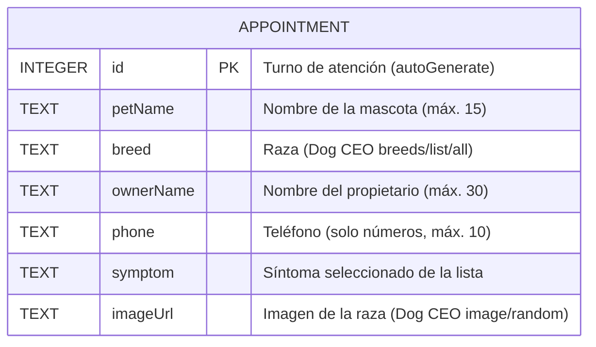

# DogApp — Agenda de Citas para Mascotas

Aplicación móvil nativa Android para la gestión de citas veterinarias, desarrollada para el **Miniproyecto 1 (Sprint 1)** de la asignatura *Desarrollo de Aplicaciones para Dispositivos Móviles* — Universidad del Valle (Escuela de Ingeniería de Sistemas y Computación, Sede Cali).

[](LICENSE)
[]()
[-green.svg)]()
[]()

---

## Descripción

**DogApp** permite al administrador de una veterinaria autenticarse mediante biometría dactilar y gestionar el ciclo completo de citas de pacientes caninos (listar, crear, consultar detalle, editar y eliminar), persistiendo la información localmente con **Room (SQLite)** y enriqueciendo los datos e imágenes de razas mediante el consumo de la API REST pública **Dog CEO**.

---

## Arquitectura y Flujo

La aplicación sigue una arquitectura **MVVM con patrón Repository**, interfaz basada en **Single-Activity + Fragments + Jetpack Navigation** y persistencia local reactiva.

```text
[ UI: Activity + Fragments (Navigation) ]
                  ↓
         [ ViewModels (MVVM) ]
                  ↓
            [ Repository ]
           ↙              ↘
[ Room / SQLite ]    [ Retrofit (Dog CEO API) ]
(Citas locales)      (Lista de razas e imágenes)
```

### Decisiones técnicas clave (según requerimientos)

| Capa / Aspecto | Tecnología / Patrón | Uso en DogApp |
|---|---|---|
| Arquitectura | MVVM + Repository | Separación de UI, estado y fuentes de datos |
| Navegación | `Fragment` + Jetpack Navigation | Flujo entre Login, Home, Nueva Cita, Detalle y Editar |
| Persistencia local | SQLite con Room | CRUD de citas y generación automática del turno (`ID`) |
| Red / API REST | Retrofit (`dog.ceo`) | Autocompletado de razas e imagen aleatoria por raza |
| Autenticación | Biometría Android (`BiometricPrompt`) | Acceso con huella digital en `HU 1.0` |
| Animaciones / UI | Lottie (`JSON`) + Material Components | Huella animada, loaders, tarjetas e inputs con foco |

---

## Historias de Usuario (Sprint 1)

Resumen rápido del alcance funcional definido para el proyecto:

| ID | Historia de Usuario | Actor | Resumen de criterios clave |
|---|---|---|---|
| **HU 1.0** | **Ventana Login** | Aplicación | Fondo gris oscuro sin toolbar, cabeza de perro transparente arriba a la derecha, título `DogApp` (fuente externa), animación Lottie de huella, diálogo biométrico (`Autenticación con Biometría`) que redirige a `HU 2.0`, e ícono personalizado `dogApp`. |
| **HU 2.0** | **Home Administrador de Citas** | Administrador | Fondo blanco con header gris oscuro curvado, lista desde Room con tarjetas (imagen circular de la raza, nombre, síntoma y `#ID` de turno), FAB rosado (`#F05861`) hacia `HU 3.0`, clic en ítem hacia `HU 4.0`. Botón atrás sale al escritorio. |
| **HU 3.0** | **Ventana Nueva Cita** | Administrador | Toolbar curvada con retroceso a `HU 2.0`. Campos validados: Mascota (`15` chars), Raza (`AutoCompleteTextView` desde 2 letras vía `breeds/list/all`), Propietario (`30` chars), Teléfono (`10` dígitos) y spinner de Síntomas quemados. Guarda en Room + imagen aleatoria (`breeds/image/random`). |
| **HU 4.0** | **Ventana Detalle de la Cita** | Administrador | Toolbar con nombre de mascota y retorno a `HU 2.0`. Tarjeta superior con imagen superpuesta sobre tarjeta inferior con turno, raza, síntoma, propietario y teléfono. Botones flotantes: eliminar (rosado, izquierda) y editar (azul oscuro, derecha → `HU 5.0`). |
| **HU 5.0** | **Ventana Editar Cita** | Administrador | Precarga datos desde `HU 4.0`. Mismas validaciones y autocompletado de raza con Retrofit que `HU 3.0`. Actualiza registro e imagen en Room y retorna a `HU 2.0`. |

### Endpoints externos (Dog CEO API)

- **Listado de razas:** `GET https://dog.ceo/api/breeds/list/all`
- **Imagen por raza / aleatoria:** `GET https://dog.ceo/api/breeds/image/random` (y endpoint por raza seleccionada)

### Modelo de datos (Room / SQLite)

Base de datos local `app_data.db` con una única tabla `Appointment`, que almacena cada cita creada en `HU 3.0` y editada en `HU 5.0`.



| Columna | Tipo | Restricción | Origen (HU) |
|---|---|---|---|
| `id` | `INTEGER` | `PRIMARY KEY`, autoincremental | Turno mostrado como `#ID` en `HU 2.0` |
| `petName` | `TEXT` | `NOT NULL`, máx. 15 caracteres | `HU 3.0` criterio 2 |
| `breed` | `TEXT` | `NOT NULL` | `HU 3.0` criterio 3 |
| `ownerName` | `TEXT` | `NOT NULL`, máx. 30 caracteres | `HU 3.0` criterio 4 |
| `phone` | `TEXT` | `NOT NULL`, solo dígitos, máx. 10 | `HU 3.0` criterio 5 |
| `symptom` | `TEXT` | `NOT NULL`, valor de la lista de síntomas | `HU 3.0` criterio 6 |
| `imageUrl` | `TEXT` | `NOT NULL` | Imagen de la raza para los ítems de `HU 2.0` y `HU 4.0` |

> Los límites de longitud y el formato numérico se validan en la UI; Room solo persiste los valores. `phone` se guarda como `TEXT` para conservar ceros iniciales.

---

## Stack y Versiones del Proyecto

### Entorno y Build (configuración actual en el repositorio)

| Herramienta / SDK | Versión | Origen |
|---|---|---|
| Gradle | `9.5.0` | `gradle-wrapper.properties` |
| Android Gradle Plugin (AGP) | `9.3.3` | `gradle/libs.versions.toml` |
| Java Compatibility | `11` | `app/build.gradle.kts` |
| `compileSdk` / `targetSdk` | `37` | `app/build.gradle.kts` |
| `minSdk` | `24` (Android 7.0) | `app/build.gradle.kts` |
| App Version | `1.0` (`versionCode = 1`) | `app/build.gradle.kts` |
| Data Binding | Habilitado (`dataBinding = true`) | `app/build.gradle.kts` |
| KSP (Kotlin Symbol Processing) | `2.3.4` | `gradle/libs.versions.toml` (compilador de Room) |

### Dependencias configuradas actualmente (`libs.versions.toml`)

| Librería | Versión | Uso |
|---|---|---|
| `androidx.core:core-ktx` | `1.19.1` | Extensiones Kotlin para Android |
| `androidx.appcompat:appcompat` | `1.8.0` | Compatibilidad de componentes UI |
| `com.google.android.material:material` | `1.14.0` | Material Design (`TextInputLayout`, `FAB`, `CardView`) |
| `androidx.activity:activity-ktx` | `1.13.0` | Soporte Edge-to-Edge y Activities en Kotlin |
| `androidx.constraintlayout:constraintlayout` | `2.2.2` | Layouts responsivos |
| `androidx.room:room-runtime` / `room-ktx` | `2.8.4` | Base de datos local SQLite (`Appointment`, `AppointmentDao`, `AppointmentDB`) |
| `androidx.room:room-compiler` (KSP) | `2.8.4` | Generación de código de Room |
| `org.jetbrains.kotlinx:kotlinx-coroutines-android` | `1.10.2` | Corrutinas (`withContext(Dispatchers.IO)` en el Repository) |
| `androidx.navigation:navigation-fragment-ktx` / `navigation-ui-ktx` | `2.9.0` | Navigation Component (`nav_graph.xml`, `NavHostFragment` en `MainActivity`) |
| `androidx.lifecycle:lifecycle-viewmodel-ktx` / `lifecycle-livedata-ktx` | `2.9.0` | `AppointmentViewModel` (`AndroidViewModel`, `viewModelScope`, `LiveData`) |
| `com.github.bumptech.glide:glide` | `4.16.0` | Carga de la imagen circular de la mascota en los ítems de `HU 2.0` |
| `junit:junit` | `4.13.2` | Pruebas unitarias locales |
| `androidx.test.ext:junit` | `1.3.0` | Extensiones JUnit para instrumentación |
| `androidx.test.espresso:espresso-core` | `3.7.0` | Pruebas de UI |

> **Por integrar durante el Sprint 1:** Retrofit + Gson/Moshi, `androidx.biometric`, Lottie (`lottie-android`).

---

## Requisitos previos e Inicio rápido

- **Android Studio** actualizado (compatible con AGP `9.3.3` y Gradle `9.5.0`)
- **JDK 11+**
- Dispositivo físico o emulador Android con **API 24+** (recomendado configurar huella digital en el emulador para probar `HU 1.0`)

### 1. Clonar el repositorio

```bash
git clone https://github.com/Ckancord33/DogApp.git
cd DogApp
```

### 2. Abrir y compilar el proyecto

1. Abrir la carpeta `DogApp` en **Android Studio** y esperar la sincronización de Gradle.
2. También es posible compilar desde terminal:

```bash
./gradlew assembleDebug
```

En Windows (PowerShell):

```powershell
.\gradlew.bat assembleDebug
```

### 3. Ejecutar pruebas

```powershell
.\gradlew.bat test
```

---

## Estructura del repositorio

```text
DogApp/
├── app/
│   ├── build.gradle.kts              # Configuración del módulo Android, dependencias y Data Binding
│   └── src/main/
│       ├── AndroidManifest.xml       # Manifiesto de la aplicación
│       ├── java/com/example/dogapp/  # Código fuente Kotlin (arquitectura MVVM)
│       │   ├── data/                 # Capa de datos (Room DAO, Database, API)
│       │   ├── model/                # Modelos y entidades
│       │   ├── repository/           # Repositorios de datos
│       │   ├── utils/                # Utilidades y constantes
│       │   ├── view/                 # Capa de interfaz de usuario
│       │   │   ├── adapter/          # Adaptadores de RecyclerView
│       │   │   ├── fragment/         # Fragments de navegación
│       │   │   ├── viewholder/       # ViewHolders de RecyclerView
│       │   │   └── MainActivity.kt   # Activity principal (aloja el NavHostFragment)
│       │   └── viewmodel/            # ViewModels (MVVM)
│       └── res/                      # Recursos (layouts, drawables, mipmaps, navigation, values, xml)
│           ├── layout/               # Layouts XML con Data Binding
│           └── navigation/           # nav_graph.xml (grafo de navegación; inicia en HomeFragment)
├── gradle/
│   ├── libs.versions.toml            # Catálogo centralizado de versiones
│   └── wrapper/                      # Gradle Wrapper (9.5.0)
├── AGENTS.md                         # Reglas y convenciones del proyecto
├── COLOR_PALETTE.md                  # Paleta de colores oficial y uso por HU
├── COURSE_STYLE_GUIDE.md             # Temas vistos en clase y estilo de código del profesor (guía para IAs)
├── build.gradle.kts                  # Configuración raíz de Gradle
├── settings.gradle.kts               # Declaración de módulos (:app)
├── LICENSE                           # Licencia MIT
└── README.md                         # Documentación principal
```

---

## Enlaces del proyecto

- **Repositorio GitHub:** [github.com/Ckancord33/DogApp](https://github.com/Ckancord33/DogApp)
- **Tablero Jira:** [Tablero Scrum — DogApp](https://correounivalle-team-lpwm25yi.atlassian.net/jira/software/projects/SCRUM/boards/1?filter=&groupBy=none&atlOrigin=eyJpIjoiNzU1MmE5YzA5MjViNGQ3ZjhmMTFlNTkzYWZhMGQ1YTAiLCJwIjoiaiJ9)
- **Docente:** Ing. Walter Medina

---

## Integrantes

Desarrollado para el curso de *Desarrollo de Aplicaciones para Dispositivos Móviles* — Universidad del Valle:

| Integrante | Código | GitHub |
|---|---|---|
| Nicolás Córdoba | `2343576` | [@Ckancord33](https://github.com/Ckancord33) |
| Daniel Andrade Reyes | `2343792` | [@Danicol1200](https://github.com/Danicol1200) |
| Juan Sebastián Sierra Cruz | `2343656` | [@Sebastian6174](https://github.com/Sebastian6174) |
| Samuel Arenas | `2341928` | [@samuelarenas2005](https://github.com/samuelarenas2005) |

---

## Licencia

MIT — ver [`LICENSE`](LICENSE).
